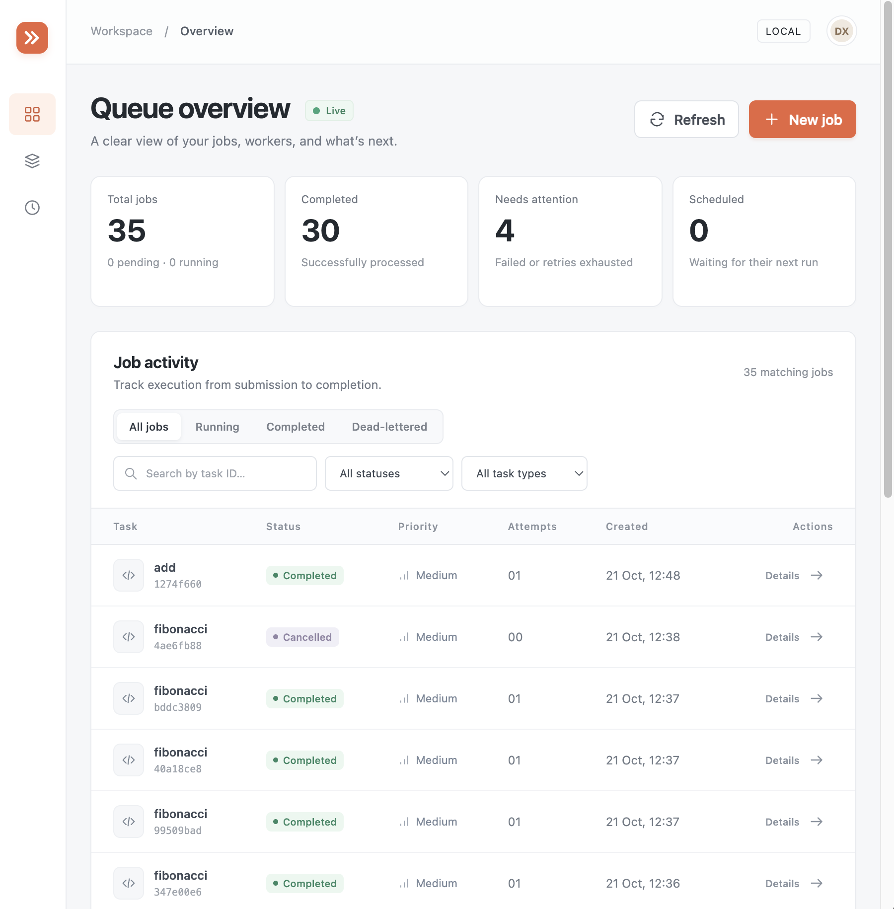
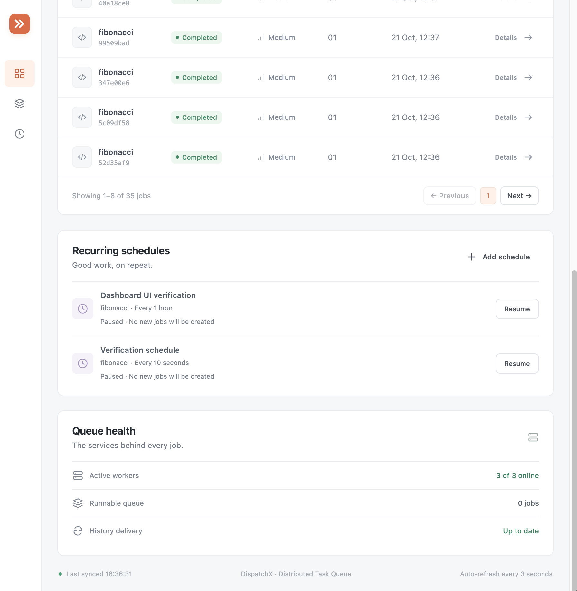
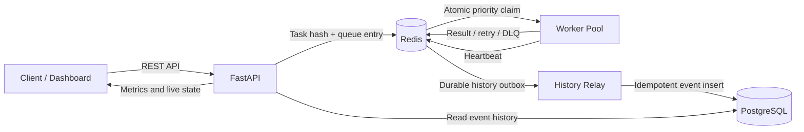

# DispatchX

**A fault-tolerant distributed task queue built with FastAPI, Redis, PostgreSQL, and Python workers.**

DispatchX accepts background jobs over HTTP, distributes them across multiple workers, and provides priorities, scheduling, retries, timeouts, dead-letter handling, crash recovery, recurring jobs, persistent execution history, metrics, and a responsive management dashboard.

It is intentionally smaller than Celery, making the queue mechanics and reliability patterns easy to inspect, run, and extend.



## Why DispatchX?

DispatchX demonstrates the core building blocks of a production-style background job system without hiding them behind a large framework:

- asynchronous job submission and polling over a validated REST API
- three workers consuming from shared high, medium, and low priority queues
- FIFO execution within each priority
- future scheduling and fixed-interval recurring jobs
- automatic retries with exponential backoff
- subprocess-based execution timeouts
- dead-letter handling after retry exhaustion
- atomic job claims with leases, execution tokens, and stale-result fencing
- worker-crash recovery with at-least-once execution semantics
- idempotent submissions to prevent duplicate client requests
- cancellable pending and scheduled jobs
- manual retries for failed and dead-lettered jobs
- Redis-backed live state with append-only persistence
- durable, eventually consistent PostgreSQL execution history
- queue metrics, worker heartbeats, and operational health reporting
- a responsive dashboard for submitting, filtering, inspecting, cancelling, and retrying jobs

## Dashboard

The dashboard is available at [`http://localhost:8000/dashboard`](http://localhost:8000/dashboard) after startup. It includes:

- live queue totals and worker health
- job search, filtering, status tabs, and pagination
- task-specific submission examples and inline JSON validation
- job results and a complete execution timeline
- cancel and retry controls based on the current job state
- recurring schedule creation, pause, and resume controls
- responsive desktop and mobile layouts



## Architecture



### Runtime services

| Service | Responsibility |
| --- | --- |
| `api` | FastAPI control plane, dashboard, validation, job management, metrics, and history queries |
| `worker1`–`worker3` | Claim and execute jobs, promote scheduled work, recover expired attempts, and update heartbeats |
| `redis` | Live task records, priority queues, scheduled work, leases, recurring schedules, metrics, idempotency keys, and history outbox |
| `postgres` | Append-only job event history |
| `history-relay` | Reliably transfers events from the Redis outbox to PostgreSQL |
| `migrate` | Applies Alembic migrations before the API and workers start |

## How jobs move through the system

```text
Immediate:  submitted -> pending -> running -> completed
Scheduled:  submitted -> scheduled -> pending -> running -> completed
Retry:      running -> scheduled (backoff) -> pending -> running
Exhausted:  running -> ... -> dead_lettered
Cancelled:  pending/scheduled -> cancelled
Recovered:  running lease expires -> scheduled retry -> pending -> running
```

Workers claim jobs atomically in `high → medium → low` order. Each running attempt receives a unique execution token and a lease deadline. If a worker dies, another worker can recover the expired attempt. A late result from the original worker is rejected because its token is no longer current.

This provides **at-least-once execution**. Task handlers that perform external side effects should still be idempotent.

## Technology stack

| Layer | Technology |
| --- | --- |
| API and validation | FastAPI, Pydantic, Uvicorn |
| Broker and live state | Redis 7 |
| Historical persistence | PostgreSQL 16, SQLAlchemy 2, Psycopg 3 |
| Database migrations | Alembic |
| Workers | Python multiprocessing |
| Image task | Pillow |
| Local orchestration | Docker Compose, Make |
| Testing | Pytest, HTTPX, SQLite for isolated history tests |
| Dashboard | Responsive HTML, CSS, and JavaScript served by FastAPI |

## Quick start

### Prerequisites

- Docker Desktop with Docker Compose
- `make` for the convenience commands below

No host Python environment is required for the Docker workflow.

### Start the complete stack

```bash
git clone https://github.com/noelroby23/distributed-task-queue.git
cd distributed-task-queue
make up
```

The first build may take a few minutes. Check that every long-running service is healthy:

```bash
make status
```

Open the local interfaces:

| Interface | URL |
| --- | --- |
| Dashboard | [http://localhost:8000/dashboard](http://localhost:8000/dashboard) |
| Swagger API documentation | [http://localhost:8000/docs](http://localhost:8000/docs) |
| ReDoc | [http://localhost:8000/redoc](http://localhost:8000/redoc) |
| Metrics JSON | [http://localhost:8000/metrics](http://localhost:8000/metrics) |

The short-lived `migrate` container should exit with status `0` after applying the database migrations. That is expected.

### Submit your first job

Use the dashboard's **New job** button, or call the API:

```bash
curl -sS -X POST http://localhost:8000/tasks \
  -H 'Content-Type: application/json' \
  -d '{
    "task_type": "fibonacci",
    "args": [20],
    "priority": "high"
  }'
```

Copy the returned `task_id`, then inspect the live state and persistent history:

```bash
curl -sS http://localhost:8000/tasks/YOUR_TASK_ID
curl -sS http://localhost:8000/history/tasks/YOUR_TASK_ID
```

## Built-in task types

| Task | Example input | Purpose |
| --- | --- | --- |
| `add` | `"args": [12, 30]` | Adds numeric positional arguments |
| `fibonacci` | `"args": [20]` | Calculates the nth Fibonacci number iteratively |
| `dummy` | `"kwargs": {"sleep_seconds": 2}` | Simulates a long-running task |
| `flaky` | `"kwargs": {"fail_count": 2}` | Demonstrates retry and backoff behavior |
| `word_count` | `"kwargs": {"text": "hello queue"}` | Counts words from inline text or a shared file |
| `image_resize` | See below | Resizes an image using Pillow |

The API rejects unknown task types before they enter the queue.

### Shared-file tasks

The host `data/` directory is mounted at `/data/` inside the API and workers. Use container paths in file-based task payloads.

```bash
curl -sS -X POST http://localhost:8000/tasks \
  -H 'Content-Type: application/json' \
  -d '{
    "task_type": "image_resize",
    "kwargs": {
      "input_path": "/data/input.png",
      "output_path": "/data/resized.png",
      "width": 320,
      "height": 240
    }
  }'
```

## Job submission options

| Field | Type | Default | Description |
| --- | --- | --- | --- |
| `task_type` | string | required | Registered task handler name; legacy `task_name` is also accepted |
| `args` | JSON array | `[]` | Positional arguments passed to the handler |
| `kwargs` | JSON object | `{}` | Keyword arguments passed to the handler |
| `priority` | `high`, `medium`, `low` | `medium` | Runnable queue priority |
| `run_at` | timezone-aware datetime | immediate | Earliest time the task may become runnable |
| `timeout_seconds` | positive integer | `30` | Execution limit for each attempt |

### Scheduled job

```bash
curl -sS -X POST http://localhost:8000/tasks \
  -H 'Content-Type: application/json' \
  -d '{
    "task_type": "fibonacci",
    "args": [25],
    "run_at": "2030-01-01T09:00:00+00:00"
  }'
```

### Idempotent submission

Send an `Idempotency-Key` header when a client may retry the same request:

```bash
curl -sS -X POST http://localhost:8000/tasks \
  -H 'Content-Type: application/json' \
  -H 'Idempotency-Key: monthly-report-2030-01' \
  -d '{"task_type":"add","args":[10,20]}'
```

Reusing the key with the same effective payload returns the original job. Reusing it with a different payload returns HTTP `409`. Keys are scoped to the configured queue and currently have no automatic expiration.

## Management API

| Method | Endpoint | Purpose |
| --- | --- | --- |
| `POST` | `/tasks` | Submit an immediate or scheduled job |
| `GET` | `/tasks` | List newest jobs with optional filters and pagination |
| `GET` | `/tasks/{task_id}` | Read the current Redis-backed job state |
| `POST` | `/tasks/{task_id}/cancel` | Cancel a pending or scheduled job |
| `POST` | `/tasks/{task_id}/retry` | Requeue a failed or dead-lettered job |
| `GET` | `/task-types` | List registered handlers |
| `GET` | `/history/tasks/{task_id}` | Read the PostgreSQL execution timeline |
| `GET` | `/schedules` | List recurring schedules |
| `POST` | `/schedules` | Create a recurring schedule |
| `PATCH` | `/schedules/{schedule_id}` | Pause or resume a schedule |
| `GET` | `/metrics` | Read queue, retry, worker, and history-delivery metrics |
| `GET` | `/dashboard` | Open the DispatchX management UI |

### List and filter jobs

```bash
curl -sS 'http://localhost:8000/tasks?status=completed&task_type=fibonacci&search=abc&offset=0&limit=25'
```

All filters are optional. `limit` accepts values from `1` to `100`.

### Cancel or retry

```bash
curl -sS -X POST http://localhost:8000/tasks/YOUR_TASK_ID/cancel
curl -sS -X POST http://localhost:8000/tasks/YOUR_TASK_ID/retry
```

Cancellation is atomic and only valid for `pending` or `scheduled` jobs. Manual retry is valid for `failed` or `dead_lettered` jobs, preserves the job ID and lifetime attempt count, and starts a fresh retry budget. Invalid state transitions return HTTP `409`.

## Recurring jobs

Recurring jobs use fixed intervals from 10 seconds to one year:

```bash
curl -sS -X POST http://localhost:8000/schedules \
  -H 'Content-Type: application/json' \
  -d '{
    "name": "Hourly calculation",
    "interval_seconds": 3600,
    "task": {
      "task_type": "fibonacci",
      "args": [20],
      "priority": "low"
    }
  }'
```

Pause a schedule:

```bash
curl -sS -X PATCH http://localhost:8000/schedules/YOUR_SCHEDULE_ID \
  -H 'Content-Type: application/json' \
  -d '{"enabled": false}'
```

Use `true` to resume it. Each occurrence creates a new job. Concurrent workers coordinate occurrence creation in one Redis transaction, preventing duplicate jobs when they race. Missed intervals coalesce into a single catch-up job. Pausing a schedule does not cancel jobs it already created.

## Retries, timeouts, and dead letters

- `MAX_RETRIES=3` permits the initial attempt plus three retries.
- Backoff delays are exponential: `1s`, `2s`, `4s` with the default retry budget.
- Retries retain their original priority.
- Each task runs in a child process so the worker can terminate it when its timeout expires.
- An unknown handler is dead-lettered immediately.
- A terminal exception or timeout is stored with failure type, reason, timestamps, and last error.
- Dead-lettered jobs remain queryable and can be manually retried.

## Persistence and history delivery

Redis is the source of truth for active job state. It runs with append-only persistence and `appendfsync everysec`, storing data in `data/redis/`.

Every lifecycle transition writes an immutable event to a Redis stream in the same transaction as the active-state change. The `history-relay` service then:

1. reads the pending outbox event;
2. inserts it into PostgreSQL using a unique event ID;
3. removes it from Redis only after the SQL commit succeeds.

If PostgreSQL is temporarily unavailable, job execution continues and history events remain queued for retry. Replaying an already-committed event is safe. The current backlog is exposed as `history_pending_events` in `/metrics`.

PostgreSQL data is held in the `dispatchx_pgdata` Docker volume. Redis persistence and PostgreSQL storage improve restart safety, but neither is a substitute for backups.

## Monitoring

`GET /metrics` reports:

- counts for `pending`, `scheduled`, `running`, `completed`, `failed`, `cancelled`, and `dead_lettered`
- runnable depth for every priority
- scheduled and dead-letter queue depth
- created, completed, retry, failure, timeout, promotion, and dead-letter totals
- active and previously seen workers with heartbeat age
- pending history-delivery events

The dashboard refreshes every three seconds and presents the same information in a human-friendly view.

## Configuration

| Variable | Purpose | Default |
| --- | --- | --- |
| `REDIS_URL` | Complete Redis URL override | unset |
| `REDIS_HOST` | Redis hostname | `localhost` |
| `REDIS_PORT` | Redis port | `6379` |
| `REDIS_PASSWORD` | Redis password | empty |
| `REDIS_DB` | Redis logical database | `0` |
| `QUEUE_NAME` | Runnable queue prefix | `task_queue` |
| `DEAD_LETTER_QUEUE_NAME` | Dead-letter list | `task_queue_dead_letter` |
| `SCHEDULED_QUEUE_NAME` | Scheduled-job sorted set | `<QUEUE_NAME>:scheduled` |
| `MAX_RETRIES` | Retries after the first attempt | `3` |
| `DEFAULT_TASK_TIMEOUT` | Per-attempt timeout in seconds | `30` |
| `WORKER_POLL_TIMEOUT` | Idle worker poll duration | `1` |
| `WORKER_HEARTBEAT_TTL` | Active-worker window in seconds | `30` |
| `WORKER_RECOVERY_GRACE` | Extra lease time before recovery | `10` |
| `DATABASE_URL` | SQLAlchemy PostgreSQL connection URL | supplied by `docker-compose.m1.yml` |

The Compose PostgreSQL credentials are for local development only. Change them before deploying anywhere shared.

## Project structure

```text
distributed-task-queue/
├── app/
│   ├── main.py              # FastAPI routes and dashboard serving
│   ├── dashboard.html       # Responsive management interface
│   ├── models.py            # Request, response, status, and priority models
│   ├── store.py             # Redis state, queues, atomic claims, metrics, controls
│   ├── worker.py            # Worker loop, subprocess execution, retries, recovery
│   ├── task_registry.py     # Built-in handlers and registration API
│   ├── recurring.py         # Fixed-interval schedule coordination
│   ├── history.py           # PostgreSQL event model and history queries
│   ├── history_store.py     # Store configuration used by API and workers
│   ├── history_relay.py     # Redis outbox to PostgreSQL delivery
│   └── config.py            # Environment-driven settings
├── migrations/              # Alembic history schema migrations
├── tests/                   # API, store, worker, management, and recovery tests
├── scripts/smoke_local.py   # Live end-to-end verification
├── data/                    # Shared task files, outputs, reports, and Redis data
├── docs/images/             # README dashboard screenshots
├── docker-compose.yml       # Redis, API, and three workers
├── docker-compose.m1.yml    # PostgreSQL, migrations, and history relay
├── Dockerfile
├── Makefile
└── requirements.txt
```

## Common commands

```bash
make up       # Build and start the complete stack
make status   # Show service health and state
make logs     # Follow API, worker, and history-relay logs
make test     # Run the automated suite in isolated Redis database 15
make smoke    # Exercise all task types against the live stack
make stop     # Stop services without deleting stored data
```

Do not use `docker compose down -v` unless you intentionally want to remove the PostgreSQL volume. Keep `data/redis/` if you want to preserve Redis state.

## Testing

The project currently has **43 automated tests** covering:

- submission, validation, status retrieval, and filtering
- priority ordering and FIFO behavior
- scheduled promotion and recurring-worker races
- retries, exponential backoff, timeouts, and dead lettering
- concurrent idempotent submissions and conflicting reuse
- cancellation and manual retry state rules
- process-kill recovery and stale-result fencing
- retry-budget exhaustion after repeated crashes
- metrics, dashboard delivery, and worker heartbeats
- PostgreSQL history storage
- simulated database outage, retained outbox events, and idempotent replay
- image output and task registry behavior

Run them with:

```bash
make test
```

Run the live verification suite with:

```bash
make smoke
```

The smoke check submits all built-in task types, scheduled work, a retry-success case, a timeout case, and a retry-exhaustion case. It saves its report and generated files under `data/smoke-<run-id>/`.

## Add a custom task

Register a handler in `app/task_registry.py`:

```python
from app.task_registry import register_task


@register_task("multiply")
def multiply(a: float, b: float, **_: object) -> float:
    return a * b
```

Rebuild the API and workers, then submit it like any other task:

```bash
make up

curl -sS -X POST http://localhost:8000/tasks \
  -H 'Content-Type: application/json' \
  -d '{"task_type":"multiply","args":[6,7]}'
```

Add focused tests for the handler and any new lifecycle behavior before extending the public API.

## Current limitations

- DispatchX is currently designed as a local development and demonstration system; it does not include authentication or per-user ownership.
- Job listing scans Redis task hashes before filtering and sorting. Add a maintained index for large job volumes.
- Recurring scheduling uses fixed intervals rather than cron expressions.
- A saturated worker pool can delay scheduled and recurring dispatch because workers perform promotion checks between jobs.
- Recurring occurrences can overlap when a previous run lasts longer than its interval.
- Jobs, history, recurring schedules, and idempotency keys have no automatic retention policy.
- At-least-once execution means external side effects still require handler-level idempotency.

## Background

DispatchX started from the [`noelroby23/distributed-task-queue`](https://github.com/noelroby23/distributed-task-queue) reference project and was expanded with PostgreSQL history, durable outbox delivery, worker-crash recovery, idempotency, job controls, recurring schedules, Redis persistence, broader testing, and a full management dashboard.

Additional implementation details are available in [FEATURES.md](FEATURES.md), and local operating notes are in [LOCAL_SETUP.md](LOCAL_SETUP.md).
